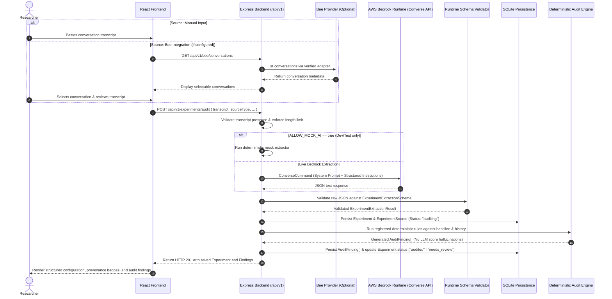
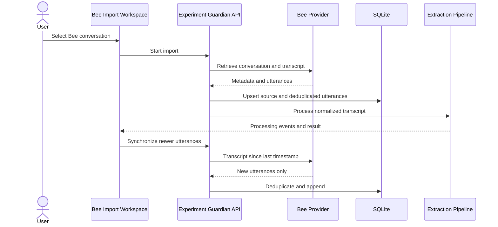

# Experiment Guardian — External API Integration Specification

- **Document ID:** EG-INT-001
- **Purpose:** Implement and verify external service integrations
- **Applies to:** AWS Bedrock Runtime and Bee Wearable AI
- **Prerequisite:** [Experiment Guardian Master Engineering Specification](file:///Users/kengzx/AWS%20hackathon/experiment_guardian/EXPERIMENT_GUARDIAN_ENGINEERING_SPEC.md)
- **Priority:** Bedrock integration first (Core MVP); Bee integration second (Optional / Discovery-first)
- **Status:** Implementation specification

---

## 1. Integration Objectives

The purpose of this specification is to define the exact technical boundaries, request/response models, verification procedures, and failure modes for external service integrations in Experiment Guardian.

| Integration | Purpose | Priority | Status |
|---|---|---|---|
| **AWS Bedrock Runtime** | Extract structured experimental facts and provenance from natural language research transcripts | **Required (MVP Core)** | Verified SDK & API patterns |
| **Bee Wearable AI** | Ingest recorded research meeting conversations/transcripts directly from the wearable device | **Optional (Post-MVP)** | Provisional / Discovery-first |

> [!IMPORTANT]
> The application must continue to function fully via manual transcript input if the Bee integration is unconfigured, unauthorized, or unavailable. Manual entry is the primary reliable baseline.

---

## 2. Integration Architecture & Data Flow

### 2.1 Logical Flow Overview



### 2.2 Architectural Invariants & Security Boundaries
1. **Zero Client-Side Credentials:** The React frontend never communicates with AWS Bedrock or the Bee API directly. AWS credentials, Bedrock bearer tokens, and Bee secrets remain exclusively server-side.
2. **Untrusted AI Output:** LLM outputs are treated as untrusted user input. Output must strictly pass Zod schema validation before persistence or processing.
3. **Decoupled Responsibilities:**
   - **Bee Provider:** Ingests source conversation and metadata.
   - **Bedrock Extractor:** Extracts facts explicitly present or flagged as inferred in the text.
   - **Audit Engine:** Pure TypeScript deterministic evaluation (missing controls, confounding changes, contradictions). Bedrock is never asked to calculate a scientific integrity score.

---

## 3. AWS Bedrock Integration

### 3.1 Official SDK and API
- **SDK Package:** `@aws-sdk/client-bedrock-runtime` (v3)
- **Primary API:** Bedrock Runtime **Converse API** via `ConverseCommand`.
  - The Converse API provides a unified, structured request/response model across modern Bedrock foundation models (Anthropic Claude 3 / 3.5, Amazon Titan, Meta Llama 3).
  - Requires the `bedrock:InvokeModel` IAM action.

Official AWS documentation references:
- [AWS Bedrock Converse API User Guide](https://docs.aws.amazon.com/bedrock/latest/userguide/conversation-inference.html)
- [AWS SDK for JavaScript v3 - Bedrock Runtime Client](https://docs.aws.amazon.com/AWSJavaScriptSDK/v3/latest/client/bedrock-runtime/)
- [AWS SDK Bedrock Runtime Code Examples](https://docs.aws.amazon.com/sdk-for-javascript/v3/developer-guide/javascript_bedrock-runtime_code_examples.html)

### 3.2 Environment Configuration

Configuration variables defined in `backend/src/config/env.ts` and loaded from `.env`:

```env
# AWS Bedrock Configuration
AWS_REGION=ap-southeast-2
BEDROCK_MODEL_ID=anthropic.claude-haiku-5-5
AWS_BEARER_TOKEN_BEDROCK=
BEDROCK_MAX_TOKENS=2048
BEDROCK_TIMEOUT_MS=30000
BEDROCK_TEMPERATURE=0
ALLOW_MOCK_AI=false

# Application Limits & Privacy
MAX_TRANSCRIPT_CHARACTERS=50000
PERSIST_TRANSCRIPTS=true
```

#### Credential Resolution Order
The backend supports two credential modes:
1. **Bedrock API Key / Bearer Token (`AWS_BEARER_TOKEN_BEDROCK`):** When provided, the Bedrock client authenticates requests using the Bedrock API key bearer token header mechanism.
2. **AWS SDK Default Credential Provider Chain:** When `AWS_BEARER_TOKEN_BEDROCK` is not provided, the SDK falls back to environment variables (`AWS_ACCESS_KEY_ID`, `AWS_SECRET_ACCESS_KEY`), AWS IAM roles (ECS task execution role, EC2 instance profile, or EKS IRSA), or local `~/.aws/credentials`.

### 3.3 Bedrock Client Initialization

File: `backend/src/integrations/bedrock/client.ts`

```typescript
import { BedrockRuntimeClient } from "@aws-sdk/client-bedrock-runtime";
import { config } from "../../config/env.js";

/**
 * Initializes the Bedrock Runtime client with appropriate credentials,
 * region, and request timeout handler.
 */
export function createBedrockClient(): BedrockRuntimeClient {
  const clientConfig: ConstructorParameters<typeof BedrockRuntimeClient>[0] = {
    region: config.awsRegion,
  };

  // Support custom Bedrock API Key bearer token authentication
  if (config.awsBearerTokenBedrock) {
    clientConfig.token = {
      token: config.awsBearerTokenBedrock,
    };
  }

  return new BedrockRuntimeClient(clientConfig);
}

export const bedrockClient = createBedrockClient();
export const bedrockModelId = config.bedrockModelId;
```

### 3.4 Extraction Service Interface & Implementation

File: `backend/src/integrations/bedrock/extractor.ts`

```typescript
import {
  ConverseCommand,
  BedrockRuntimeClient
} from "@aws-sdk/client-bedrock-runtime";
import { bedrockClient, bedrockModelId } from "./client.js";
import { config } from "../../config/env.js";
import {
  extractionSystemPrompt,
  buildExtractionPrompt
} from "../../extraction/extraction-prompt.js";
import {
  ExperimentExtractionResult,
  ExperimentExtractionSchema
} from "../../extraction/experiment-schema.js";
import { normalizeExtractionResult } from "../../extraction/normalize.js";
import { BedrockIntegrationError } from "./bedrock-errors.js";

export interface ExperimentExtractor {
  extract(input: {
    transcript: string;
    sourceType: "manual" | "bee";
    sourceReference?: string | null;
  }): Promise<ExperimentExtractionResult>;
}

export class BedrockExtractor implements ExperimentExtractor {
  constructor(
    private client: BedrockRuntimeClient = bedrockClient,
    private modelId: string = bedrockModelId
  ) {}

  async extract(input: {
    transcript: string;
    sourceType: "manual" | "bee";
    sourceReference?: string | null;
  }): Promise<ExperimentExtractionResult> {
    if (!input.transcript || !input.transcript.trim()) {
      throw new BedrockIntegrationError("INVALID_INPUT", "Transcript cannot be empty");
    }

    if (input.transcript.length > config.maxTranscriptCharacters) {
      throw new BedrockIntegrationError(
        "INPUT_TOO_LARGE",
        `Transcript exceeds maximum length of ${config.maxTranscriptCharacters} characters`
      );
    }

    // Set up request abort signal for timeout
    const controller = new AbortController();
    const timeoutId = setTimeout(() => controller.abort(), config.bedrockTimeoutMs);

    try {
      const command = new ConverseCommand({
        modelId: this.modelId,
        system: [{ text: extractionSystemPrompt }],
        messages: [
          {
            role: "user",
            content: [{ text: buildExtractionPrompt(input.transcript) }],
          },
        ],
        inferenceConfig: {
          maxTokens: config.bedrockMaxTokens,
          temperature: config.bedrockTemperature,
        },
      });

      const response = await this.client.send(command, {
        abortSignal: controller.signal,
      });

      const textBlocks = response.output?.message?.content
        ?.filter((block): block is { text: string } => typeof block.text === "string")
        .map((block) => block.text) ?? [];

      const rawText = textBlocks.join("\n").trim();
      if (!rawText) {
        throw new BedrockIntegrationError(
          "EMPTY_RESPONSE",
          "Bedrock returned no usable text content"
        );
      }

      // Strip markdown code fences if present (e.g. ```json ... ```)
      const cleanedJson = rawText
        .replace(/^```(?:json)?\s*/i, "")
        .replace(/\s*```$/i, "")
        .trim();

      let parsed: unknown;
      try {
        parsed = JSON.parse(cleanedJson);
      } catch (err) {
        throw new BedrockIntegrationError(
          "MALFORMED_JSON",
          "Failed to parse model response as valid JSON",
          { rawPreview: rawText.slice(0, 200) }
        );
      }

      // Zod validation against expected schema
      const validationResult = ExperimentExtractionSchema.safeParse(parsed);
      if (!validationResult.success) {
        throw new BedrockIntegrationError(
          "SCHEMA_VALIDATION_ERROR",
          "Model response does not match the experiment extraction schema",
          { issues: validationResult.error.issues }
        );
      }

      // Normalize without hallucinating defaults
      return normalizeExtractionResult(validationResult.data, {
        provider: "aws-bedrock",
        modelId: this.modelId,
      });
    } catch (err: any) {
      if (err.name === "AbortError" || controller.signal.aborted) {
        throw new BedrockIntegrationError(
          "TIMEOUT",
          `Bedrock invocation timed out after ${config.bedrockTimeoutMs}ms`
        );
      }
      if (err instanceof BedrockIntegrationError) {
        throw err;
      }
      throw BedrockIntegrationError.fromAwsError(err);
    } finally {
      clearTimeout(timeoutId);
    }
  }
}
```

### 3.5 Extraction Prompting & Schema Requirements

#### System Instructions (`backend/src/extraction/extraction-prompt.ts`)
The extraction prompt must strictly guide the model:
1. **Factual Grounding:** Extract only facts explicitly stated in the transcript.
2. **Preserve Unknowns:** If a parameter (learning rate, random seed, dataset split) is not mentioned, use `null`. **Never hallucinate defaults** (e.g., do not set seed to 42 or learning rate to 0.001 unless stated).
3. **Handle Ambiguities:** When researchers say "we might try 0.01 or stick with 0.001", record an ambiguity entry in `ambiguities[]` rather than guessing.
4. **Separate Baseline from Proposed:** Clearly isolate baseline parameters from experimental intervention parameters.
5. **No Scientific Auditing in Prompt:** Do not evaluate whether the experiment was good or bad. Extract raw facts only.
6. **Strict JSON Output:** Return only valid JSON conforming directly to `ExperimentExtractionSchema`.

---

## 4. IAM Permissions and AWS Configuration

### 4.1 Least-Privilege IAM Policy

When deploying with standard IAM credentials or an IAM role (such as ECS Task Role or EC2 Instance Profile), grant only `bedrock:InvokeModel`:

```json
{
  "Version": "2012-10-17",
  "Statement": [
    {
      "Sid": "InvokeExperimentExtractionModel",
      "Effect": "Allow",
      "Action": [
        "bedrock:InvokeModel"
      ],
      "Resource": [
        "arn:aws:bedrock:ap-southeast-2:669668106588:inference-profile/anthropic.claude-haiku-5-5",
        "arn:aws:bedrock:ap-southeast-2::foundation-model/anthropic.claude-haiku-5-5"
      ]
    }
  ]
}
```

> [!NOTE]
> The resource ARNs above must match the target AWS region, AWS Account ID, and model identifier or cross-region inference profile ARN. If using an AWS Bedrock API Key bearer token, access permissions are governed directly by the API key's assigned IAM policy.

### 4.2 AWS Verification Checklist

- [ ] Verify that Amazon Bedrock is enabled in the selected region (`ap-southeast-2`).
- [ ] Confirm that model access for the specified model (`anthropic.claude-haiku-5-5`) is granted in the AWS Bedrock Console.
- [ ] Verify whether the model identifier requires an inference profile prefix (e.g., `apac.anthropic...` or `anthropic.claude-haiku-5-5`).
- [ ] Verify that `AWS_BEARER_TOKEN_BEDROCK` or AWS IAM credentials have valid expiration periods and permissions.

---

## 5. Bee Integration (Discovery-First & Fallback)

### 5.1 Verification Status: Provisional
The Bee Wearable AI platform is treated as a separate external service. In accordance with Section 10 of the Master Specification:
- **No invented endpoints:** Do not guess Bee endpoints (such as `/api/v1/conversations`).
- **Discovery First:** Live interaction with Bee must be validated against official Bee SDK / developer documentation before enabling.
- **Strict Fallback:** The application defaults to `BEE_ENABLED=false`, offering full functionality through manual transcript paste.

### 5.2 Proposed Application-Side Adapter Interface

File: `backend/src/integrations/bee/bee-provider.ts`

```typescript
export interface BeeConversationSummary {
  id: string;
  title: string | null;
  timestamp: string | null;
}

export interface BeeConversation {
  id: string;
  title: string | null;
  transcript: string;
  timestamp: string | null;
  sourceReference: string | null;
}

export interface BeeProvider {
  /**
   * Returns whether valid credentials and configuration exist for Bee.
   */
  isConfigured(): boolean;

  /**
   * Lists available recorded conversations from the device or cloud.
   * Marked provisional pending official Bee SDK capability verification.
   */
  listConversations(options?: {
    limit?: number;
    cursor?: string | null;
  }): Promise<{
    items: BeeConversationSummary[];
    nextCursor: string | null;
  }>;

  /**
   * Retrieves full conversation transcript for auditing.
   * Marked provisional pending official Bee SDK capability verification.
   */
  getConversation(id: string): Promise<BeeConversation>;
}
```

### 5.3 Application-Owned Backend Endpoints

These are **Experiment Guardian backend routes**, not third-party Bee routes:

| Route | Method | Description | Behavior When Bee Unconfigured |
|---|---|---|---|
| `/api/v1/bee/status` | `GET` | Reports if Bee is enabled and configured | Returns `{ "configured": false, "available": false }` |
| `/api/v1/bee/conversations` | `GET` | Lists conversations for selection | Returns HTTP 501 / `{ error: "Bee integration not configured" }` |
| `/api/v1/bee/conversations/:id` | `GET` | Retrieves transcript by ID | Returns HTTP 501 / `{ error: "Bee integration not configured" }` |

---

## 6. Error Handling & Observability

### 6.1 Standard Error Categories

All external integration errors must be normalized into typed errors with safe codes:

| Failure Mode | Error Code | HTTP Status | User-Facing Message | Safe Server Log |
|---|---|---|---|---|
| Missing Env Config | `CONFIG_ERROR` | 500 | AI service configuration is incomplete | Missing key in env: `BEDROCK_MODEL_ID` |
| Invalid AWS Token / Auth | `AUTH_ERROR` | 502 | Failed to authenticate with AI service | Bedrock client authentication rejected |
| Access Denied (IAM) | `PERMISSION_DENIED` | 502 | Insufficient permissions to access AI model | IAM denied bedrock:InvokeModel for model ARN |
| Model Not Found / Unsupported | `MODEL_UNAVAILABLE` | 502 | Configured model is unavailable in this region | ResourceNotFoundException for modelId |
| Throttling / Rate Limit | `RATE_LIMITED` | 429 | AI service busy; please retry in a moment | ThrottlingException, retry backoff initiated |
| Request Timeout | `TIMEOUT` | 504 | Extraction request timed out | Bedrock invocation exceeded timeout (30000ms) |
| Non-JSON Response | `MALFORMED_OUTPUT` | 502 | Unable to parse structured experiment data | JSON parse error on model response |
| Zod Schema Mismatch | `VALIDATION_FAILED` | 422 | Extracted data could not be validated | Schema validation failed on `training.learningRate` |
| Bee Unconfigured | `BEE_NOT_CONFIGURED` | 501 | Bee wearable integration is not configured | Bee integration requested but `BEE_ENABLED=false` |

### 6.2 Safe Logging Practices
- **No Secrets in Logs:** Never log `AWS_BEARER_TOKEN_BEDROCK`, AWS Secret Keys, or Bee tokens.
- **No Transcript Leaks in Standard Logs:** In production, do not log raw conversation transcripts. Only log transcript metadata (e.g. SHA-256 hash, length in characters).

---

## 7. Testing & Verification Strategy

### 7.1 Unit Tests (Mocked - No AWS Credentials Required)
- Verify `BedrockExtractor` handles valid JSON responses matching `ExperimentExtractionSchema`.
- Verify handling of markdown code fences (` ```json ` wrapping).
- Verify rejection of invalid JSON, empty text, or malformed schema payloads.
- Verify timeout abort behavior using mock timers.
- Verify that unknown parameters remain `null` and are not replaced with defaults.

### 7.2 Live Integration Smoke Test (Optional / Manual)
- Script: `backend/tests/integration/bedrock-smoke.test.ts`
- Runs only when `RUN_LIVE_TESTS=true` and valid Bedrock credentials exist in `.env`.
- Sends a known test transcript and validates:
  1. Successful HTTP 200 from AWS Bedrock Converse API.
  2. Zod parse succeeds without schema errors.
  3. Correct identification of explicit hyperparameters.

### 7.3 Fallback Contract Tests
- Test that `POST /api/v1/experiments/audit` functions seamlessly when `sourceType: "manual"` and `BEE_ENABLED=false`.
- Test that `/api/v1/bee/*` endpoints return clean non-crashing 501 / disabled status when unconfigured.

---

## 8. Implementation Plan & Milestones

| Phase | Milestone | Deliverables | Acceptance Criteria |
|---|---|---|---|
| **Phase A** | Bedrock Setup & Env Validation | `env.ts`, `.env`, Bedrock client factory | Client instantiates without errors; missing env flags immediate error |
| **Phase B** | Extraction Service & Zod Validation | `extractor.ts`, `extraction-prompt.ts`, `normalize.ts` | ConverseCommand executes; output parses into typed schema; unit tests pass |
| **Phase C** | End-to-End Extraction & Audit | Connect to `POST /api/v1/experiments/audit` & DB | Submitting manual transcript extracts, validates, saves to SQLite, and runs audit |
| **Phase D** | Bee Discovery | Research & document verified Bee developer interface | Documented authentication mechanism and capabilities, or confirmed unavailable |
| **Phase E** | Bee Adapter & Fallback | `bee-provider.ts`, `bee-service.ts`, `/api/v1/bee/*` | Clean fallback when disabled; supported operations work if verified |
| **Phase F** | End-to-End Verification | Full test suite, test fixtures A–J, report generation | All tests pass; live or mock extraction verifiable end-to-end |

---

## 9. Consistency Cross-Check with Master Specification

- **Schema Alignment:** The fields in `ExperimentExtractionSchema` directly map to `Experiment` defined in [EXPERIMENT_GUARDIAN_ENGINEERING_SPEC.md](file:///Users/kengzx/AWS%20hackathon/experiment_guardian/EXPERIMENT_GUARDIAN_ENGINEERING_SPEC.md#L450-L530).
- **Audit Engine Separation:** Strictly preserves the rule that AI extraction never performs audit evaluation.
- **Database Alignment:** Stored records adhere to the SQLite schema defined in migration `001-initial-schema.sql`.
- **Bee Policy:** Bee remains strictly optional, preserving manual transcript entry as the primary path.

---

## 10. Approved Integration Extension — Bee Research Memory and Copilot

This section extends the existing integration specification without removing its original safeguards. Manual transcript input remains supported. The original discovery-first rule continues to apply to every external operation, even when a broader provider capability has been verified.

### 10.1 Product Integration Goal

Experiment Guardian is a **continuous research memory and reproducibility copilot that turns Bee-captured lab discussions into traceable experiment records, audits them, and helps researchers resolve missing information through conversation**.

“Continuous” refers to capturing and connecting the research process across conversations: meetings, informal decisions, abandoned ideas, parameter changes, and follow-up commitments. It does not imply continuous physiological, vehicle, or environmental telemetry.

### 10.2 Updated Bee Verification Status

As of October 17, 2026, official Bee documentation verifies support for:

- Conversation listing.
- Full conversation and transcript retrieval.
- Incremental transcript retrieval using a `since` epoch-millisecond value.
- Related-conversation discovery.
- Daily summaries, facts, and todos.
- CLI commands with JSON output.
- A developer API under `/v1/*` with supported authentication modes.
- An MCP server exposing Bee context to supported assistants.

References:

- [Bee developer overview](https://docs.bee.computer/)
- [Bee CLI](https://docs.bee.computer/docs/cli)
- [Bee API](https://docs.bee.computer/docs/api)
- [Bee MCP](https://docs.bee.computer/docs/mcp)
- [Bee Developer Mode](https://docs.bee.computer/docs/developer-mode)

This updates the earlier provisional status but does not authorize guessed endpoint paths or response fields. Capture real CLI/API fixtures with secrets and private transcript content removed before finalizing parsers.

### 10.3 Provider Strategy

Implement provider adapters behind a common contract:

```typescript
export interface BeeProvider {
  isConfigured(): Promise<boolean>;
  getConnectionStatus(): Promise<BeeConnectionStatus>;
  listConversations(input?: {
    cursor?: string;
    limit?: number;
  }): Promise<{
    items: BeeConversationSummary[];
    nextCursor: string | null;
  }>;
  getConversation(id: string): Promise<BeeConversation>;
  getTranscriptSince(id: string, since?: number): Promise<BeeUtterance[]>;
  findRelatedConversations(id: string, limit?: number): Promise<BeeConversationSummary[]>;
}
```

Provider priority:

1. **Bee CLI provider:** First live implementation. Invoke verified commands with JSON output, strict timeouts, bounded output, and safe process execution without shell interpolation.
2. **Bee public API provider:** Add after exact endpoint and response contracts are verified and covered by sanitized fixtures.
3. **Bee MCP provider:** Optional agent/development path. The core backend must not silently depend on a local MCP server.
4. **Mock provider:** Tests and local demonstrations only. Label it clearly and never present it as proof of Bee-track integration.

Verified CLI operations include:

```text
bee status
bee conversations list --limit <n> --json
bee conversations list --cursor <cursor> --json
bee conversations get <id> --json
bee conversations transcript <id> --json
bee conversations transcript <id> --since <epochMs> --json
bee conversations related <id> --limit <n> --json
```

Pass every argument as a process argument array. Validate conversation IDs, cursors, limits, and timestamps before invocation. Never concatenate user-controlled values into a shell command.

### 10.4 Bee Synchronization Contract

Synchronization workflow:



Requirements:

- Store the provider conversation ID separately from the internal UUID.
- Persist the last successfully synchronized utterance timestamp.
- Deduplicate using stable provider identity when available, otherwise a deterministic composite hash.
- Make imports idempotent.
- Hash normalized source content.
- Do not invoke Bedrock again when the content hash is unchanged.
- Treat transcript text as sensitive data under the existing retention policy.
- Preserve speaker and timestamp information when Bee supplies it.
- Label live, cached, mock, and manual sources distinctly.

### 10.5 Extended Bee Application Endpoints

These are Experiment Guardian routes, not claims about Bee's third-party endpoint names:

| Route | Method | Purpose |
|---|---|---|
| `/api/v1/bee/status` | `GET` | Report provider, authentication, and availability without returning secrets |
| `/api/v1/bee/conversations` | `GET` | List available conversations with cursor pagination |
| `/api/v1/bee/conversations/:id` | `GET` | Retrieve safe conversation metadata and transcript for review |
| `/api/v1/bee/conversations/:id/related` | `GET` | List verified related conversations |
| `/api/v1/bee/conversations/:id/import` | `POST` | Import a selected conversation into the extraction pipeline |
| `/api/v1/bee/conversations/:id/sync` | `POST` | Retrieve and persist only newer utterances |
| `/api/v1/bee/imports/:workflowId/events` | `GET` | Stream sanitized server-sent processing events |

Import and sync requests return a workflow ID. Long-running work must not keep the initial HTTP request open when a queued workflow and event stream provide a more reliable interface.

### 10.6 Bedrock Stage 1 — Structured Extraction

Retain the existing extraction contract and extend the schema to represent:

- Decision state: proposed, confirmed, rejected, abandoned, or superseded.
- Speaker and timestamp provenance.
- Commitments and owners.
- Unresolved questions.
- References to earlier experiments or decisions.

The Stage 1 response remains untrusted until it passes Zod validation. It cannot generate audit findings.

### 10.7 Bedrock Stage 2 — Audit Explanation

Create a separate service and prompt for post-audit explanation:

```typescript
interface AuditExplanationService {
  explain(input: {
    experiment: Experiment;
    findings: AuditFinding[];
    baseline: Experiment | null;
    evidence: Provenance[];
  }): Promise<AuditExplanation>;
}
```

The output schema must contain:

- Finding IDs being explained.
- Plain-language explanation.
- Evidence references.
- Clarification questions.
- Recommended investigation steps.
- Optional reproducibility checklist items.

The service must not add findings, change severity, resolve findings, or modify stored experiment values. It may be disabled or fail independently without preventing deterministic audit completion.

### 10.8 Bedrock Stage 3 — Tool-Using Research Copilot

Implement an experiment-scoped chat endpoint backed by an explicit allowlist of tools:

| Tool | Access | Purpose |
|---|---|---|
| `get_experiment` | Read | Retrieve the current validated record |
| `get_audit_findings` | Read | Retrieve deterministic findings |
| `search_experiment_history` | Read | Find relevant prior experiments |
| `get_source_evidence` | Read | Retrieve field or finding provenance |
| `list_related_bee_conversations` | Read | Find related source conversations |
| `get_bee_conversation_transcript` | Read | Retrieve a permitted source transcript |
| `build_reproducibility_checklist` | Read/derive | Produce grounded checklist data |
| `propose_experiment_revision` | Proposal only | Create a reviewable, unapplied revision |

Do not expose unrestricted SQL, filesystem access, arbitrary HTTP requests, or direct record mutation to the model.

Conversation requirements:

- Scope each thread to an experiment and authorized user session.
- Validate every tool input and output.
- Limit tool iterations and total model tokens.
- Cite evidence in factual answers.
- State when evidence is unavailable or conflicting.
- Record safe tool summaries for the UI.
- Keep source evidence separate from model-generated chat content.
- Require an explicit non-model API call to apply or reject a proposed revision.

### 10.9 Revision Endpoints

| Route | Method | Purpose |
|---|---|---|
| `/api/v1/experiments/:id/revisions` | `GET` | List proposed, applied, and rejected revisions |
| `/api/v1/experiments/:id/revisions` | `POST` | Create a proposal from a user or approved copilot tool |
| `/api/v1/experiments/:id/revisions/:revisionId/apply` | `POST` | Explicitly apply a proposal and rerun the audit |
| `/api/v1/experiments/:id/revisions/:revisionId/reject` | `POST` | Reject a proposal without changing the experiment |

Applying a revision must be transactional: create the immutable revision record, update the current experiment projection, rerun deterministic rules, and persist the new audit result. If any required step fails, roll back the transaction.

### 10.10 Copilot Endpoints

| Route | Method | Purpose |
|---|---|---|
| `/api/v1/experiments/:id/explanation` | `POST` | Generate or refresh the grounded post-audit explanation |
| `/api/v1/experiments/:id/copilot/threads` | `POST` | Create an experiment-scoped thread |
| `/api/v1/experiments/:id/copilot/threads/:threadId/messages` | `POST` | Send a message and begin a bounded tool workflow |
| `/api/v1/experiments/:id/copilot/threads/:threadId` | `GET` | Retrieve messages, citations, and safe tool events |
| `/api/v1/experiments/:id/copilot/threads/:threadId/events` | `GET` | Stream assistant and tool status events |

Assistant responses must distinguish:

- Source facts.
- Extracted structured values.
- Deterministic findings.
- Model-generated explanations or suggestions.

### 10.11 Observable Processing Events

Use a common event envelope:

```typescript
interface ProcessingEvent {
  id: string;
  workflowId: string;
  experimentId: string | null;
  type: ProcessingEventType;
  status: "started" | "completed" | "skipped" | "failed";
  label: string;
  toolName?: string;
  ruleId?: string;
  timestamp: string;
  durationMs?: number;
  summary?: string;
  safeMetadata?: Record<string, string | number | boolean | null>;
}
```

Initial event types:

```text
bee.import.started
bee.import.completed
bee.sync.completed
extraction.started
extraction.completed
validation.completed
audit.started
audit.rule.started
audit.rule.completed
audit.completed
report.started
report.completed
assistant.tool.started
assistant.tool.completed
workflow.failed
```

Event rules:

- Events represent actual backend transitions, not timer-based simulated progress.
- Reconnect using the standard SSE event ID / `Last-Event-ID` behavior where practical.
- Never include credentials, complete hidden prompts, chain-of-thought, or unrestricted transcript bodies.
- Use user-readable labels while preserving stable machine event types.
- A failed stage remains visibly failed until retried or replaced by a new workflow.

### 10.12 Research Decision Observatory UI Integration

The frontend consumes processing events to render:

- Bee conversation and transcript nodes.
- Bedrock extraction activity.
- Zod validation status.
- Deterministic audit rule activity.
- Report generation.
- Copilot tool activity.

Use React Three Fiber and Three.js for the lazy-loaded 3D processing scene and Framer Motion for interface transitions. The visual must be a projection of event state. It must not infer or simulate backend completion.

Provide a fully functional 2D pipeline when WebGL is unavailable or `prefers-reduced-motion` is enabled. The report, evidence, errors, retry controls, and revision actions must never depend on 3D interaction.

### 10.13 Extended Error Categories

Add these normalized errors:

| Failure Mode | Error Code | HTTP Status | User-Facing Behavior |
|---|---|---|---|
| Bee CLI unavailable | `BEE_CLI_UNAVAILABLE` | 503 | Explain installation or provider configuration requirement |
| Bee not authenticated | `BEE_AUTH_REQUIRED` | 401 | Ask the user to complete the official login flow |
| Invalid Bee response | `BEE_RESPONSE_INVALID` | 502 | Preserve existing cached data and report a provider parsing problem |
| Bee command timeout | `BEE_TIMEOUT` | 504 | Allow a bounded retry |
| Sync conflict | `BEE_SYNC_CONFLICT` | 409 | Preserve prior data and request review |
| Explanation unavailable | `EXPLANATION_UNAVAILABLE` | 502 | Keep deterministic report usable |
| Copilot tool rejected | `COPILOT_TOOL_REJECTED` | 400 | Explain that the requested operation is outside the allowlist |
| Revision conflict | `REVISION_CONFLICT` | 409 | Refresh the experiment and proposal before applying |
| Workflow not found | `WORKFLOW_NOT_FOUND` | 404 | Stop the event view and offer a safe restart |

### 10.14 Privacy and Security Extensions

- Bee tokens and CLI credentials remain server-side or in the official local Bee credential store.
- Do not copy Bee credentials into frontend storage.
- Do not expose transcript content in ordinary logs or processing event metadata.
- Apply transcript retention and deletion policy to imported Bee utterances.
- Display the source scope before the copilot searches another conversation.
- Prevent prompt injection in transcript content from changing tool permissions or system behavior.
- Treat transcript instructions as quoted research content, not application commands.
- Limit related-conversation retrieval and disclose it in visible tool activity.
- Sanitize report exports and filenames.

---

## 11. Extended Integration Milestones

These milestones refine the original Phase D through Phase F entries and align with the master engineering specification.

| Phase | Milestone | Deliverables | Acceptance Criteria |
|---|---|---|---|
| **Phase D1** | Verified Bee CLI Access | Developer Mode checklist, status probe, typed CLI runner, sanitized fixtures | Real account status is detected without exposing credentials |
| **Phase D2** | Conversation Discovery | List, paginate, retrieve, and related-conversation operations | A real conversation and transcript can be reviewed in the UI |
| **Phase E1** | Bee Import and Provenance | Conversation/utterance persistence, import workflow, source evidence | A real Bee source produces a traceable experiment record |
| **Phase E2** | Incremental Synchronization | `since` retrieval, cursor/timestamp state, deduplication, content hashing | Repeated sync is idempotent and new utterances are appended once |
| **Phase E3** | Post-Audit Explanation | Separate Bedrock prompt, schema, storage/cache policy | Explanations cite findings and cannot modify them |
| **Phase E4** | Research Copilot | Thread API, allowlisted tools, citations, bounded orchestration | Answers are grounded and write suggestions remain unapplied proposals |
| **Phase E5** | Revision Workflow | Proposal review, apply/reject endpoints, transactional re-audit | Only explicit Apply changes the record and all history remains visible |
| **Phase E6** | Processing Observability | Workflow IDs, SSE endpoint, safe event envelope | UI activity matches real backend stages and reconnects safely |
| **Phase E7** | Observatory UI | Bee workspace, 3D/2D pipeline, evidence report, copilot drawer | Full workflow remains usable without animation or WebGL |
| **Phase F1** | Live End-to-End Verification | Real Bee data, live Bedrock extraction, deterministic audit, copilot explanation | Two-conversation demo proves longitudinal research memory |
| **Phase F2** | Reliability and Submission | Security, accessibility, performance, report export, demo recording | Tests pass and the submission visibly demonstrates actual Bee use |

### 11.1 Required End-to-End Demonstration

The final demonstration should show:

1. A first real Bee-captured research discussion imported as a baseline experiment.
2. Bedrock extracting explicit facts and preserving unknowns.
3. Zod validating the structured response.
4. Deterministic rules producing an initial audit.
5. A second Bee conversation adding or changing experimental context.
6. Experiment Guardian connecting the later discussion to the baseline.
7. A deterministic finding such as a missing control or confounded comparison.
8. The copilot explaining the finding and visibly using evidence tools.
9. A proposed revision reviewed by the user.
10. Explicit application of the revision followed by deterministic re-audit.
11. A final evidence-linked reproducibility report.

The demo must identify whether each external operation is live, cached, or mocked. Only live Bee-recorded data satisfies the Bee integration portion of the demonstration.

### 11.2 Extended Test Matrix

- Unit-test CLI argument validation and response parsing with sanitized fixtures.
- Test timeouts, missing CLI, unauthenticated state, malformed output, and nonzero process exit.
- Test cursor pagination and `since` timestamp handling.
- Test idempotent import and utterance deduplication.
- Test that unchanged content does not trigger extraction.
- Test prompt-injection text inside a Bee transcript cannot call tools or alter system instructions.
- Test post-audit explanations cite only supplied finding IDs and evidence.
- Test copilot tool limits, authorization, citations, and absent-evidence responses.
- Test that a model cannot directly apply a revision.
- Test transactional revision application and audit rerun.
- Test processing event order, sanitization, reconnection, failure, and retry.
- Test 3D lazy loading, 2D fallback, reduced motion, keyboard access, and responsive layouts.
- Report live Bedrock and live Bee smoke tests separately from mocked automated tests.

---

## 12. Approved Integration Extension — Alexa+ MCP and Multimodal Research Intake

### 12.1 Scope and Precedence

This extension preserves the Bedrock and Bee contracts above. It makes Alexa+ the primary track through a Streamable HTTP MCP server and web-based conversational simulation. AWS Builder remains a mini-challenge through Bedrock and optional Amazon Transcribe. Bee is an optional source and must not be required for application startup or the primary demo.

### 12.2 Integration Topology

```text
First-party Research Assistant ─┐
External Alexa-style client ────┼─> Streamable HTTP MCP `/mcp`
Agent Skill consumer ───────────┘              │
                                               v
                                     MCP tool handlers
                                               │
                                               v
                                     application services
                                   /        |        \
                           extraction     audit     revisions
                               |             |          |
                           Bedrock     deterministic   approval

Source inputs:
  browser speech transcript | text | file | audio | optional Bee CLI
```

The first-party assistant shall invoke MCP tools rather than calling domain repositories directly. This proves the same integration used by an external Alexa-style agent.

### 12.3 MCP Transport Contract

Endpoint:

```text
POST   /mcp
GET    /mcp
DELETE /mcp
```

Implementation requirements:

- Use Streamable HTTP from a maintained MCP SDK.
- Support protocol initialization and capability negotiation.
- Validate origin and authentication settings according to deployment mode.
- Bind tool handlers to existing services through a narrow adapter layer.
- Keep transport session state separate from assistant sessions.
- Bound request bodies, tool text inputs, result size, and execution time.
- Return protocol errors without leaking stack traces or secrets.

Local hackathon mode may use localhost without user authentication. Any shared deployment must add authentication and per-user authorization before exposing private research data.

### 12.4 MCP Tool Contracts

#### `create_experiment_from_transcript`

Input:

```json
{
  "transcript": "string",
  "sourceType": "conversation|meeting_notes|browser_voice|audio_transcript|bee|demo",
  "sourceReference": "string|null",
  "title": "string|null"
}
```

Output includes `experimentId`, structured experiment, extraction metadata, audit run, findings, evidence links, and a display summary.

#### `get_experiment`

Input: `experimentId`.

Output includes current experiment, latest audit, revisions, decisions, and source metadata.

#### `list_experiments`

Input supports bounded `limit`, optional status, and optional text query.

#### `audit_experiment`

Input: `experimentId`.

Output includes immutable `auditRunId`, score/status, findings, and rule version.

#### `get_audit_report`

Input: `experimentId` and optional `auditRunId`.

#### `explain_audit_finding`

Input: `experimentId`, `findingId`, and optional user question. The response must be grounded in the stored finding and evidence.

#### `record_research_decision`

Input includes experiment ID, decision text, rationale, alternatives, source evidence, and actor.

#### `propose_experiment_revision`

Input includes experiment ID, allowlisted field path, proposed value, reason, and evidence. It returns a proposal and approval requirement; it does not modify the experiment.

#### `approve_experiment_revision`

Input includes `revisionId` and `approvalRequestId`. Approval applies the exact persisted proposal and triggers a new audit.

#### `reject_experiment_revision`

Input includes `revisionId`, `approvalRequestId`, and optional reason.

#### `compare_experiment_versions`

Input includes experiment ID and two revision or audit identifiers.

#### `generate_reproducibility_report`

Input includes experiment ID, output format, and optional audit run ID. Initial format is JSON/Markdown; PDF is a later presentation enhancement.

### 12.5 Tool Safety Classification

| Tool class | Examples | Execution rule |
|---|---|---|
| Read | get, list, compare, explain | May execute immediately |
| Compute | audit, report | May execute immediately and persists immutable output where applicable |
| Create | create experiment, record decision | Requires clear user intent in the originating message |
| Propose | propose revision | May create a pending proposal |
| Governed mutation | approve/reject revision | Requires exact pending approval ID and explicit user action |

The assistant must not construct an approval on behalf of the user. Approval endpoints must verify that the request is pending, belongs to the revision and session, and has not expired or already been resolved.

### 12.6 Assistant Session API

#### Create session

```text
POST /api/v1/assistant/sessions
```

Request:

```json
{
  "experimentId": "uuid|null",
  "sourceId": "uuid|null",
  "title": "string|null"
}
```

#### Send message

```text
POST /api/v1/assistant/sessions/:sessionId/messages
```

Request:

```json
{
  "content": "string",
  "clientMessageId": "string",
  "attachments": ["source-id"]
}
```

Use `clientMessageId` for idempotency. The response contains the stored user message, assistant status, and event stream URL. A short synchronous response is permitted when processing completes within the request deadline.

#### Retrieve session

```text
GET /api/v1/assistant/sessions/:sessionId
```

Returns session, messages, recent tool invocations, pending approvals, and linked experiment summary.

#### Event stream

```text
GET /api/v1/assistant/sessions/:sessionId/events
Accept: text/event-stream
```

Use event IDs and support `Last-Event-ID` where the persistence design permits replay.

#### Resolve approval

```text
POST /api/v1/assistant/approvals/:approvalId/approve
POST /api/v1/assistant/approvals/:approvalId/reject
```

### 12.7 Bedrock Conversation Contract

Bedrock has three distinct responsibilities:

1. Extract structured information from confirmed source text.
2. Select from an allowlisted MCP tool set during conversation.
3. Explain deterministic findings and tool results in user-facing language.

The orchestration request shall include:

- a concise system contract,
- active experiment/session identifiers,
- recent bounded conversation history,
- available tool schemas,
- relevant tool results and evidence,
- an instruction to state uncertainty and never fabricate identifiers or evidence.

The application must validate tool inputs after model generation. A tool result is the source of truth even when it conflicts with the model's prior statement.

### 12.8 Source Intake API

#### Text source

```text
POST /api/v1/sources/text
Content-Type: application/json
```

Accepts text, source type, optional name, and metadata.

#### File source

```text
POST /api/v1/sources/files
Content-Type: multipart/form-data
```

Initial accepted types: plain text, Markdown, PDF, and DOCX. The server validates content type, extension, signature where practical, and configured size limits.

#### Recorded audio source

```text
POST /api/v1/sources/audio
Content-Type: multipart/form-data
```

When Amazon Transcribe is configured, this creates a transcription job or performs a bounded synchronous workflow. Otherwise return a stable `TRANSCRIPTION_NOT_CONFIGURED` error without affecting text-based use.

#### Browser voice transcript

Browser speech recognition sends confirmed text through `/sources/text` using source type `browser_voice`. Interim browser transcription is never treated as evidence until the user submits it.

### 12.9 Amazon Transcribe Integration

Recorded audio is the preferred AWS enhancement. Real-time streaming is deferred.

Required configuration when enabled:

```text
TRANSCRIBE_ENABLED=false
TRANSCRIBE_LANGUAGE_CODE=en-US
TRANSCRIBE_INPUT_BUCKET=
TRANSCRIBE_OUTPUT_BUCKET=
TRANSCRIBE_JOB_TIMEOUT_MS=120000
MAX_AUDIO_BYTES=
```

Integration rules:

- Generate collision-resistant job names.
- Use least-privilege S3 and Transcribe permissions.
- Delete temporary objects according to the configured retention policy.
- Normalize the completed transcript into a source artifact.
- Preserve timestamps and speaker labels when returned.
- Never submit audio to extraction before transcription succeeds.
- Do not store raw audio by default after successful transcription unless retention is explicitly enabled.

### 12.10 Document Extraction

Document extractors shall return:

```ts
interface ExtractedSource {
  text: string;
  mediaType: string;
  originalName: string | null;
  locators: Array<{
    start: number;
    end: number;
    page?: number;
    paragraph?: number;
    timestampMs?: number;
    speaker?: string;
  }>;
  warnings: string[];
}
```

Malformed, encrypted, unsupported, or image-only documents must produce actionable errors. OCR is outside the first implementation unless added explicitly.

### 12.11 Observable Tool Events

Every MCP invocation initiated by the first-party assistant shall persist and emit:

```json
{
  "eventId": "uuid",
  "sessionId": "uuid",
  "type": "tool.started",
  "timestamp": "ISO-8601",
  "toolInvocationId": "uuid",
  "toolName": "audit_experiment",
  "display": {
    "label": "Running reproducibility audit",
    "experimentId": "uuid"
  }
}
```

Raw transcripts, prompts, and complete tool payloads must not be included in SSE display payloads. The detail API may return authorized redacted inputs and outputs.

### 12.12 Error Categories

Add these stable error codes:

- `MCP_PROTOCOL_ERROR`
- `MCP_SESSION_NOT_FOUND`
- `MCP_TOOL_NOT_FOUND`
- `MCP_TOOL_INPUT_INVALID`
- `MCP_TOOL_TIMEOUT`
- `ASSISTANT_SESSION_NOT_FOUND`
- `ASSISTANT_MESSAGE_DUPLICATE`
- `ASSISTANT_MODEL_ERROR`
- `APPROVAL_NOT_FOUND`
- `APPROVAL_ALREADY_RESOLVED`
- `APPROVAL_REVISION_MISMATCH`
- `SOURCE_TYPE_UNSUPPORTED`
- `SOURCE_TOO_LARGE`
- `SOURCE_EXTRACTION_FAILED`
- `MICROPHONE_TRANSCRIPT_EMPTY`
- `TRANSCRIPTION_NOT_CONFIGURED`
- `TRANSCRIPTION_FAILED`
- `TRANSCRIPTION_TIMEOUT`

### 12.13 Agent Skill Integration

The Agent Skill shall point to the MCP server and include task guidance, examples, error recovery, and approval rules. It shall be testable without Bee. The skill must tell the agent to:

- retrieve current state before proposing changes,
- run audits through the tool,
- cite evidence and finding IDs,
- ask only for information needed to resolve a concrete gap,
- propose rather than directly change experiment fields,
- wait for explicit approval,
- rerun the audit after an approved revision.

### 12.14 Demo and Offline Contracts

Demo mode shall use committed fixtures through a provider interface. It must not intercept or fake MCP transport responses at the frontend. Demo actions shall invoke the real backend, MCP tools, audit engine, revision workflow, and event stream.

When live Bedrock credentials are unavailable, an explicitly labeled deterministic model fixture may demonstrate navigation and UI development. The hackathon judging path should use live Bedrock where available and show provider status.

## 13. Revised Integration Milestones

### Milestone A — MCP transport and read tools

- Protocol initialization
- Tool discovery
- Get/list/audit/report tools
- Stable errors and safe logs

### Milestone B — Create and conversational orchestration

- Create-from-transcript tool
- Assistant sessions/messages
- Bedrock tool selection
- Invocation persistence

### Milestone C — approvals and revisions

- Proposal and approval tools
- Backend enforcement
- Automatic re-audit

### Milestone D — intake adapters

- Browser voice transcript
- Text, Markdown, PDF, DOCX
- Optional Amazon Transcribe recorded audio
- Optional Bee CLI

### Milestone E — observable demo and Agent Skill

- SSE event stream
- Tool timeline
- Agent Skill package
- Deterministic scenarios
- Five-minute end-to-end demonstration

### 13.1 Required Resilient Demonstration

The release candidate must demonstrate:

1. Create a session.
2. Submit a spoken, pasted, uploaded, or demo transcript.
3. Observe Bedrock select the creation/audit tools.
4. Display extracted fields with source evidence.
5. Display deterministic audit gaps.
6. Ask the assistant whether the experiment is reproducible.
7. Supply missing values conversationally.
8. Review and explicitly approve revision proposals.
9. Observe a new immutable audit run.
10. Generate an evidence-linked report.
11. Show the MCP tool history.
12. Complete all steps without Bee access.

---

## 14. Alexa+ Session Conductor Integration

### 14.1 Precedence and Purpose

This section strengthens Sections 12 and 13. Alexa+ is the primary voice agent and session conductor, while Experiment Guardian supplies governed research capabilities through MCP. The web application simulates Alexa+ and serves as its visual companion for the hackathon demonstration.

### 14.2 Alexa-Oriented MCP Tools

Add these high-level tools. They compose existing lower-level tools and application services.

#### `start_experiment_session`

Input:

```json
{
  "title": "string|null",
  "sourceMode": "voice|text|upload|demo",
  "clientRequestId": "string"
}
```

Output includes session ID, status, optional experiment ID, suggested spoken response, and visual state.

#### `add_experiment_observation`

Input:

```json
{
  "sessionId": "uuid",
  "text": "string",
  "clientObservationId": "string",
  "observedAt": "ISO-8601|null"
}
```

The service stores the observation, extracts candidate information, creates or updates only through the governed workflow, audits when appropriate, and returns the next recommended action. Duplicate `clientObservationId` values are idempotent.

#### `get_active_experiment`

Input: `sessionId`.

Returns active experiment, latest audit summary, pending approval, and unresolved question.

#### `ask_next_reproducibility_question`

Input: `sessionId` and optional excluded finding IDs.

Returns one structured question selected from deterministic findings:

```json
{
  "findingId": "uuid",
  "question": "What random seed did you use?",
  "reason": "The current record does not specify a seed.",
  "severity": "high",
  "expectedFieldPaths": ["training.randomSeed"]
}
```

#### `confirm_experiment_action`

Input:

```json
{
  "sessionId": "uuid",
  "approvalRequestId": "uuid",
  "decision": "approve|reject",
  "clientConfirmationId": "string"
}
```

The server verifies session binding, pending state, exact revision set, expiry, and idempotency before resolution.

#### `pause_experiment_session`

Stores session state and unresolved conversational context.

#### `resume_experiment_session`

Input includes an exact session ID or a bounded search phrase. Ambiguous results return candidates rather than selecting automatically.

#### `finish_experiment_session`

Runs the final audit, generates a report, marks the session completed, and returns a concise speech summary plus visual report identifiers.

### 14.3 Speech and Visual Result Envelope

Alexa-oriented MCP tools shall return:

```ts
interface AlexaToolResult<T> {
  data: T;
  speech: {
    text: string;
    shouldListen: boolean;
    confirmationRequired: boolean;
  };
  visual: {
    view: "session" | "experiment" | "audit" | "approval" | "report";
    experimentId?: string;
    findingId?: string;
    approvalRequestId?: string;
    reportId?: string;
    highlight?: string[];
  };
  nextAction:
    | "listen"
    | "ask_follow_up"
    | "request_confirmation"
    | "show_report"
    | "none";
}
```

Speech text must be concise. Structured identifiers drive the visual companion and must not be inferred from prose.

### 14.4 Session API Extensions

```text
POST /api/v1/alexa/sessions/start
POST /api/v1/alexa/sessions/:sessionId/observations
POST /api/v1/alexa/sessions/:sessionId/pause
POST /api/v1/alexa/sessions/:sessionId/resume
POST /api/v1/alexa/sessions/:sessionId/next-question
POST /api/v1/alexa/sessions/:sessionId/confirm
POST /api/v1/alexa/sessions/:sessionId/finish
GET  /api/v1/alexa/sessions/:sessionId/state
```

These endpoints are first-party simulator adapters over the same services used by MCP tools. They may not implement separate audit or revision behavior.

### 14.5 Proactive Question Selection Contract

The selector accepts the latest audit findings, active experiment state, questions already asked, user-dismissed gaps, and pending approvals. It returns at most one question.

Selection must be deterministic by default using severity, blocking status, rule priority, and stable finding order. Bedrock may rewrite the selected question for natural speech but may not change its meaning, expected fields, or finding association.

### 14.6 Confirmation Security

An approval request shall contain:

- approval request ID,
- session ID,
- exact revision IDs,
- expected experiment version,
- human-readable and speech summaries,
- status,
- expiry,
- creation timestamp,
- resolution timestamp and actor when resolved.

Affirmative language is evaluated only when an unexpired approval is the session's current pending action. Ambiguous input returns `CONFIRMATION_AMBIGUOUS`. Unrelated messages clear or suspend the confirmation turn according to the conversation policy and never apply the change.

Additional error codes:

- `ALEXA_SESSION_NOT_ACTIVE`
- `ALEXA_SESSION_AMBIGUOUS`
- `ALEXA_OBSERVATION_DUPLICATE`
- `ALEXA_NO_ACTIVE_EXPERIMENT`
- `ALEXA_NO_FOLLOW_UP_AVAILABLE`
- `CONFIRMATION_NOT_PENDING`
- `CONFIRMATION_EXPIRED`
- `CONFIRMATION_AMBIGUOUS`

### 14.7 Pause and Resume Contract

Pause persists the last completed invocation, unresolved question, pending approval, active experiment, and last event ID. Resume reconciles any invocation left in a nonterminal state before accepting another observation.

Resume by phrase returns candidate sessions when confidence is insufficient:

```json
{
  "status": "selection_required",
  "candidates": [
    { "sessionId": "uuid", "title": "ResNet experiment", "updatedAt": "ISO-8601" }
  ]
}
```

### 14.8 Alexa+ Agent Skill Requirements

The skill must include:

- role as a hands-free lab session conductor,
- supported intents and example utterances,
- active-experiment context rules,
- observation capture and idempotency,
- proactive question selection,
- decision/rationale preservation,
- read-back and explicit confirmation,
- pause/resume behavior,
- concise speech and detailed visual handoff,
- tool error recovery,
- instruction never to fabricate missing experimental details.

### 14.9 Required Integration Verification

Verify the full workflow through MCP or the thin simulator adapter:

1. start a voice session,
2. add an observation,
3. create and audit an experiment,
4. retrieve a deterministic follow-up question,
5. answer it and create a revision proposal,
6. create a bound approval request,
7. approve the exact action,
8. re-audit,
9. pause and resume with active context,
10. finish and generate the final report,
11. use returned visual identifiers to open the correct UI state.
