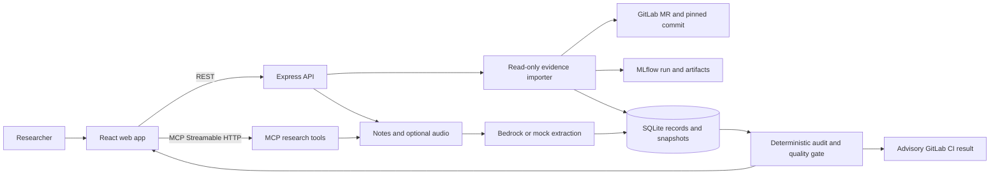

# Experiment Guardian

**New: GitLab + MLflow linked experiment reviews.** Paste a merge request URL and a run ID in **Experiments** to fetch read-only source evidence, compare it with the research record, and keep immutable snapshots. The setup, logging convention, and advisory GitLab CI job are described in [Connected ML workflow](docs/CONNECTED_ML_WORKFLOW.md).

The home page opens **Experiments**. To start without a run ID, choose **Audit meeting notes** there. Open **Discuss this run in the Alexa lab** from a linked review to keep the conversation attached to that experiment. The [recommended single-scenario judge demo](docs/JUDGE_DEMO.md) includes exact inputs and expected responses; [Alexa+ Q&A reference](docs/ALEXA_QA_REFERENCE.md) covers the other deterministic follow-up questions.

**Alexa+ research memory and reproducibility copilot**  
*Alexa+ hackathon project with optional AWS and Bee adapters*

Experiment Guardian converts informal research conversations and meeting notes into structured experiment records, detects confounding variables and missing experimental controls, and preserves immutable audit evidence before researchers trust or reproduce results.

---

## Architecture Overview



REST and MCP are two paths into the same backend. The linked-run path works without an LLM; notes and the conversational MCP session remain optional.

---

## Prerequisites

- **Node.js**: v20+ or v24+
- **npm**: v10+
- **AWS Bedrock**: (Optional for local testing with `ALLOW_MOCK_AI=true`, required for live extraction)

---

## Installation & Setup

1. **Clone and install dependencies:**
   ```bash
   npm install
   ```

2. **Configure Environment Variables:**
   Copy the example environment file:
   ```bash
   cp .env.example .env
   ```

   Configure your `.env` settings:
   ```env
   NODE_ENV=development
   PORT=3001

   DATABASE_PATH=./data/experiment-guardian.sqlite

   AWS_REGION=ap-southeast-2
   BEDROCK_MODEL_ID=anthropic.claude-haiku-5-5
   AWS_BEARER_TOKEN_BEDROCK=your-bedrock-token-or-key
   BEDROCK_MAX_TOKENS=2048
   BEDROCK_TIMEOUT_MS=30000
   BEDROCK_TEMPERATURE=0

   # Set to true for offline testing or local development
   ALLOW_MOCK_AI=false

   PERSIST_TRANSCRIPTS=true
   MAX_TRANSCRIPT_CHARACTERS=50000

   BEE_ENABLED=false
   FRONTEND_ORIGIN=http://localhost:5173
   ```

---

## Running the Application

### 1. Start Both Backend and Frontend Concurrently:
```bash
npm run dev
```
- **Frontend**: http://localhost:5173
- **Backend API**: http://localhost:3001
- **Health Check**: http://localhost:3001/api/v1/health

### 2. Start Services Independently:
```bash
# Terminal 1: Backend
npm run dev:backend

# Terminal 2: Frontend
npm run dev:frontend
```

---

## Running Tests

Run the full automated test suite (backend unit & integration tests + frontend contract tests):
```bash
npm test
```

### Run specific workspace test suites:
```bash
# Backend tests (Unit, Schema, Database, Audit Rules, E2E vertical slice)
npm run test:backend

# Frontend tests (API client and request handling)
npm run test:frontend
```

---

## Live AWS Bedrock vs. Mock Mode

- **Live Bedrock Extraction (`ALLOW_MOCK_AI=false`):** Calls AWS Bedrock Converse API (`@aws-sdk/client-bedrock-runtime`) using `ConverseCommand` and your configured Bearer Token / AWS IAM credentials.
- **Mock Extraction (`ALLOW_MOCK_AI=true`):** Uses the deterministic rule-based extractor for local offline testing and CI workflows.
- **Note on AWS Account Verification:** If your AWS account is currently undergoing verification or model access grant, AWS Bedrock will return `AccessDeniedException`. The backend catches and formats this into a structured `PERMISSION_DENIED` error without leaking credentials or crashing. Set `ALLOW_MOCK_AI=true` in `.env` to test the vertical slice locally while AWS verification completes.

---

## Implemented API Endpoints (`/api/v1`)

| Endpoint | Method | Description |
|---|---|---|
| `/api/v1/health` | `GET` | Health status and configuration indicators |
| `/api/v1/experiments/audit` | `POST` | Ingests transcript, extracts parameters, persists to SQLite, and runs audit |
| `/api/v1/experiments` | `GET` | Paginated listing of recorded experiments |
| `/api/v1/experiments/:id` | `GET` | Full experiment details, latest findings, immutable finding history, and linked investigations |
| `/api/v1/sources/demo/:id/load` | `POST` | Create a new database-backed reproducibility demo record with separate stored artifact metadata |
| `/api/v1/experiments/:id/policy` | `PUT` | Enable the ML research policy and rerun the audit |
| `/api/v1/experiments/:id/artifacts` | `POST` | Append user-supplied artifact metadata and rerun the audit |
| `/api/v1/experiments/:id/artifact-files` | `POST` | Store an uploaded artifact file, check its SHA-256 hash, and rerun the audit |
| `/api/v1/experiments/:id/quality-gate` | `GET` | Read pass, warn, block, or not-configured decision from the latest audit |
| `/api/v1/experiments/linked-review` | `POST` | Start from a GitLab merge request URL and MLflow run ID |
| `/api/v1/experiments/:id/linked-evidence` | `POST` | Append a fresh, pinned evidence snapshot to an existing experiment |
| `/api/v1/experiments/linked-review/lookup` | `GET` | Find a merge request's advisory CI review |
| `/api/v1/experiments/:id/audit` | `GET` | Audit findings for a specific experiment |
| `/api/v1/audits/:findingId` | `PATCH` | Updates finding status (`resolved`, `accepted`, `dismissed`) with notes |
| `/api/v1/bee/status` | `GET` | Bee wearable AI integration readiness status |

---

## Database-backed evidence demos

The Alexa+ Lab Copilot page has two additional demo controls:

- **Stored configuration conflict:** the note records seed 42, dataset v2, and learning rate 0.001. Separate persisted artifact metadata records seed 7, dataset v1, and no learning rate. The common audit service raises `SEED_MISMATCH`, `DATASET_VERSION_MISMATCH`, and `MISSING_TRAINING_PARAMETER`.
- **Missing result evidence:** the note reports 91% accuracy, but the persisted record lacks an evaluation script, result file, and model checkpoint. The audit raises three corresponding critical findings.

Each click creates a fresh experiment, source, policy assignment, artifact records, and audit run in SQLite. Open **Stored evidence and quality gate** from the linked experiment page to see note values beside stored values. Approved experiment revisions and newly attached artifacts trigger a fresh audit. Earlier runs and findings remain visible; a prior open finding is marked resolved when a later run no longer detects it.

The `ml-research` policy requires run, dataset, training, evaluation, result, checkpoint, and dependency lock evidence. The gate blocks on critical or missing/conflicting evidence, warns when evidence is only a demo fixture or typed metadata, and passes only when required fields have matching retained files. Upload run, dataset, training, and result artifacts as JSON objects; scripts, checkpoints, and lockfiles can be uploaded as files up to 10 MB. Uploaded bytes are retained in SQLite, hashed, and available for download. A verified state means the stored file matches its SHA-256 hash and the extracted metadata matches the research record; it does not establish that a scientific result is correct.

This is a local artifact gate. It does not yet fetch Git commits, dataset objects, or model registry entries from external systems, and it has no authenticated reviewer override or production CI enforcement.

The read-only gate can be inspected from a terminal with `node scripts/check-quality-gate.mjs https://your-guardian.example <experiment-uuid>`. It exits nonzero for `block` and `not_configured`; set `EXPERIMENT_GUARDIAN_FAIL_ON_WARN=true` to fail on `warn` as well. Manual GitHub Actions and GitLab CI examples are in `examples/ci/`. They demonstrate check reporting against a chosen experiment ID. Do not use the public, mutable demo service as a protected merge gate until authentication, repository-to-experiment binding, and immutable audit snapshot pinning are added.

---

## Alexa+ Lab Copilot

The current primary hackathon experience is an Alexa+ Lab Copilot simulation backed by a real Streamable HTTP MCP server. Alexa+ acts as the hands-free session conductor while Experiment Guardian provides structured extraction, deterministic auditing, evidence, governed revisions, and reports.

Open `http://localhost:5173/` after starting the application. The main workflow supports:

- browser microphone transcription with editable text,
- pasted research observations,
- TXT, Markdown, PDF, and DOCX meeting-note imports,
- optional recorded audio through Amazon Transcribe,
- clearly labeled deterministic demo scenarios,
- proactive questions selected from audit findings,
- exact approval or rejection of proposed revisions,
- pause and resume with persisted experiment context,
- actual tool invocation history and processing events,
- evidence-linked Markdown reports,
- optional Bee conversation import.

The web experience is a visual companion and standards-based Alexa+ simulation. External clients can use the same tool capabilities through `POST /mcp`, `GET /mcp`, and `DELETE /mcp`.

## Public deployment

The repository includes a production `Dockerfile` and a no-card `render.yaml` for a free judge demo. The cloud container serves the React application, REST API, and Streamable HTTP MCP endpoint from one HTTPS origin. Free deployments use temporary SQLite storage; `render.persistent.yaml` is available for paid durable storage.

See [Public deployment](docs/DEPLOYMENT.md) for the Render and Alexa AI CLI steps.

## Submission materials

- [Project description](docs/SUBMISSION.md)
- [Judge demo: fixed inputs and expected responses](docs/JUDGE_DEMO.md)
- [Alexa+ question and answer reference](docs/ALEXA_QA_REFERENCE.md)
- [Other three-minute demo options](docs/DEMO_SCRIPT.md)
- [Product feedback and friction log](docs/FEEDBACK_AND_FRICTION_LOG.md)
- [Public deployment guide](docs/DEPLOYMENT.md)

## Demonstration configuration

The repeatable judge build uses browser speech recognition and the deterministic local extractor. The Amazon Bedrock, Amazon Transcribe/S3, and Bee adapters remain in the source and can be enabled through environment variables when the connected accounts permit them. Current account-level blockers and tested workarounds are documented in the feedback and friction log.

### Alexa+ Agent Skill

The packaged skill is at [`agent-skill/SKILL.md`](agent-skill/SKILL.md). It describes session control, proactive follow-up, safe confirmation, tool use, interruption handling, and visual handoff.

### Optional Amazon Transcribe

Recorded audio is disabled until configured:

```env
TRANSCRIBE_ENABLED=true
TRANSCRIBE_LANGUAGE_CODE=en-US
TRANSCRIBE_INPUT_BUCKET=your-private-input-bucket
TRANSCRIBE_OUTPUT_BUCKET=your-private-output-bucket
TRANSCRIBE_JOB_TIMEOUT_MS=120000
MAX_AUDIO_BYTES=25000000
```

The AWS identity running the backend needs the least-privilege S3 permissions for the configured buckets and permissions for starting and reading Amazon Transcribe jobs. Uploaded input audio is deleted after the job finishes or fails.

### New integration endpoints

| Endpoint | Method | Purpose |
|---|---|---|
| `/mcp` | `POST`, `GET`, `DELETE` | MCP Streamable HTTP transport |
| `/api/v1/capabilities` | `GET` | Bedrock, MCP, voice, document, Transcribe, and Bee readiness |
| `/api/v1/alexa/sessions` | `GET` | Recent persisted Alexa+ sessions |
| `/api/v1/alexa/sessions/start` | `POST` | Start a hands-free research session |
| `/api/v1/alexa/sessions/:id/observations` | `POST` | Add an idempotent research observation |
| `/api/v1/alexa/sessions/:id/events` | `GET` | Live Server-Sent Events for tools and workflow state |
| `/api/v1/alexa/sessions/:id/confirm` | `POST` | Resolve the exact pending approval |
| `/api/v1/alexa/sessions/:id/pause` | `POST` | Pause while preserving context |
| `/api/v1/alexa/sessions/:id/resume` | `POST` | Resume persisted context |
| `/api/v1/alexa/sessions/:id/finish` | `POST` | Final audit and report generation |
| `/api/v1/sources/text` | `POST` | Store confirmed text with provenance |
| `/api/v1/sources/files` | `POST` | Extract text from TXT, Markdown, PDF, or DOCX |
| `/api/v1/sources/audio` | `POST` | Transcribe configured audio through Amazon Transcribe |
| `/api/v1/sources/demo` | `GET` | List clearly labeled demo scenarios |
| `/api/v1/reports/:id` | `GET` | Retrieve a generated reproducibility report |
